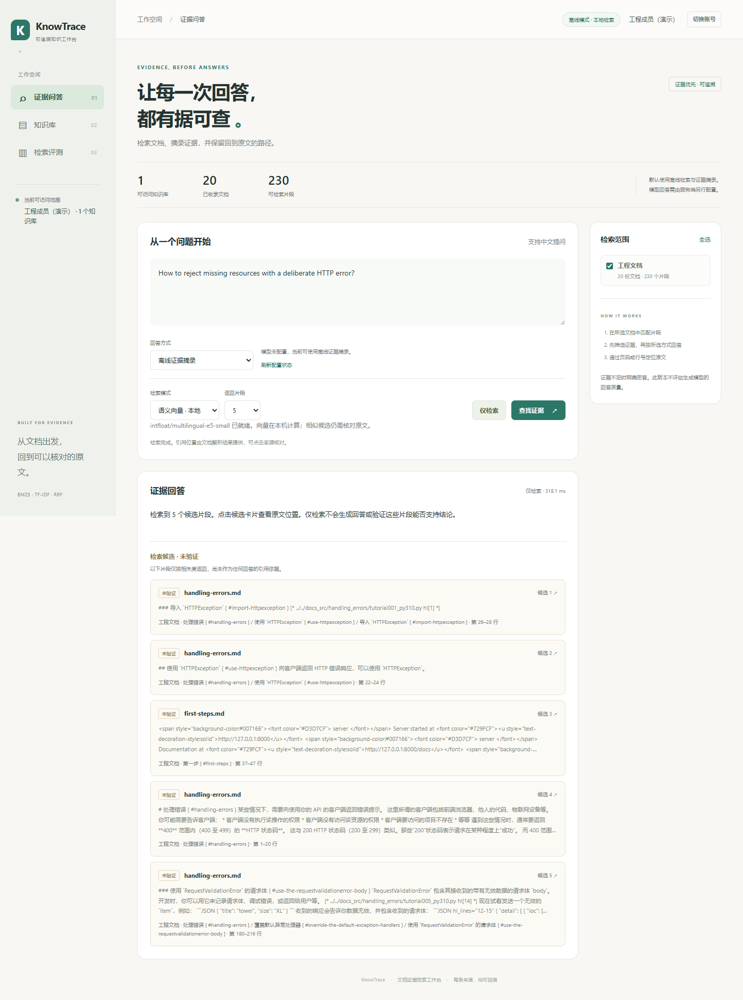

# KnowTrace · 可追溯文档工作台

[](https://github.com/zhangjiashuai170-debug/knowtrace/actions/workflows/tests.yml)

本地优先的文档检索与证据问答工作台。上传文档、限定知识库权限、比较词法与语义检索，查看可定位的原文引用和可复跑评测。

**v0.3默认离线检索与证据摘录。** 新增可选的本地E5语义召回、向量＋词法RRF及权限范围内持久向量缓存；原词法混合仍为默认。可配置Ollama或Chat Completions兼容服务，再选择模型回答。2026-11-07已用DeepSeek官方服务完成合成资料真实联调；其他供应商仅有模拟协议测试。当前没有GraphRAG或Agent工具执行。



## 运行

需要 Python 3.11+（本机验证为 Windows / Python 3.12）。首次安装依赖需要联网；演示语料已包含，默认词法演示的运行、解析、检索、评测不需要网络、密钥或下载模型。可选语义检索需先单独准备本地模型，生成回答需显式配置模型服务。

```powershell
cd <项目目录>
powershell -ExecutionPolicy Bypass -File scripts/setup.ps1
powershell -ExecutionPolicy Bypass -File scripts/start.ps1
```

打开 http://127.0.0.1:8766 。端口冲突时运行 `scripts/start.ps1 -Port 8767`。

Linux/macOS：

```bash
python3 -m venv .venv
.venv/bin/python -m pip install -r requirements-lock.txt
.venv/bin/python -m pip install --no-deps -e .
.venv/bin/python -m knowtrace.cli seed
.venv/bin/python -m knowtrace.cli serve
```

依赖锁定文件来自本机实际安装。其他系统可能需要按 `pyproject.toml` 重新解析平台依赖。

## 演示路径

1. 以「工程成员」登录，询问 FastAPI 的路径参数、请求体或异常处理，打开已采用的引用，核对原文、标题和行号。
2. 上传 PDF / Markdown / TXT / DOCX。PDF 引用真实物理页，其他文本引用标题和行号。PDF 扫描图像不提供 OCR；没有可提取文本时应拒绝导入。
3. 切换「支持成员」后工程文档不可见，检索、来源下载与删除也受同一权限控制。支持手册是明确标注的合成演示数据。
4. 提一个当前文档不支持的问题，查看拒答及独立标注的「未验证候选」；「仅检索」不把相似片段自动当作支持结论的引用。
5. 在评测页分别运行 BM25、字符 TF-IDF、Hybrid，查看实际报告与失败用例。开发集和测试集分开标记。
6. 以管理员创建知识库。导入按文件内容 SHA-256 在每个知识库内去重；重启不会清空上传。
7. 需要时按 `docs/MODEL_SETUP.md` 为服务进程配置模型。配置存在不证明在线，默认回答方式仍是离线摘录。

三个账号的公开演示密码为 `admin-demo`、`engineer-demo`、`support-demo`，分别对应 `admin`、`engineer`、`support`。这不是生产身份认证。服务默认仅监听127.0.0.1，不应直接暴露公网。

## 架构与边界

```text
本地文件 → 格式解析 → 带页/行定位的分块 → SQLite + 托管原文件
                                      ↓
演示身份 → 知识库权限过滤 → BM25 / 字符 TF-IDF → RRF融合
                                      ↓
                             覆盖率门槛 → 证据摘录 / 拒答
                                      ↓
                               来源核验 + 离线评测
```

- 核心库与 HTTP / UI 解耦，ACL 在排名前过滤；`None` 表示管理员全权，空列表表示无权访问任何库。
- 中文采用jieba自带离线词典且禁用HMM，英语做保守词形归一化。BM25与字符TF-IDF仍是词法匹配，无法保证跨语言和语义改写命中。Hybrid为reciprocal-rank fusion，不是嵌入向量检索。
- 可选`semantic`使用384维本地E5 ONNX向量；`semantic_hybrid`融合两条词法排序与向量排序。两者只扩展候选，回答继续通过原证据准入。模型准备、单段编码的批次独立性与实际回归结果见[本地语义检索](docs/SEMANTIC_RETRIEVAL.md)和[v0.3验收](docs/VALIDATION-v0.3.md)。
- 所有文档均视为数据，文档中的命令/网址不会被执行。离线路径不联网；可选模型路径仅请求启动时显式配置的服务，没有代码执行或工具权限。
- PDF 为物理页码；DOCX 是提取后的段落/表格文本行，不伪称原排版页码。Markdown 源文件中的外部代码 include 仅作为原始文本，未抓取远端代码。
- 拒答为内容词覆盖及显式约束启发式，不能保证语义正确或彻底识别无答案问题。候选与实际引用分开，模型输出也只检查引用格式/ID，不验证语义蕴含。
- 上传最多20MB，文件托管、不接受任意本地路径；原文强制下载；前端用文本渲染证据。带压缩数据的文件还有解析器级限制，见测试。
- 会话为本地签名 HttpOnly Cookie，仅允许localhost/127.0.0.1主机名，跨域写操作被拒绝；正式部署还需真实身份、TLS、审计、并发限额、恶意文件隔离和持久任务队列。

## 评测

```powershell
.venv/Scripts/python.exe -m pytest
.venv/Scripts/python.exe -m knowtrace.cli evaluate --mode all --split test
```

20篇固定提交的 FastAPI 官方中文文档，100题（80可答、20不可答），开发/测试各50。题目标注是 **AI辅助、原文核对草稿，未独立人工复核**。不是行业基准，也不证明生产效果。语料、许可证、精确来源和SHA见 `demo/`。

- Recall@1/3/5、MRR：仅可回答题，期望文档先按清单哈希绑定到文档ID，再使用检索候选独立计算。同名异内容文件不计命中。排名单位是chunk，一个文档可占多个位置。
- 拒答准确率：仅不可回答题。误拒答率：仅可回答题。
- P50/P95：同机顺序运行、检索预热后的 `ask` 耗时，包含检索和证据拼装，不是冷启动或多用户吞吐。
- 新增预期来源实际采用率、无答案接受率，避免只放宽门槛获得漂亮数字。逐题通过要求实际采用了期望文档，不只是在Top K内找到。
- 不使用大模型打分，不把召回率写成「回答准确率」。评测答案从不写入检索索引，评测不调用可选模型。
- v0.1的测试分组已查看，v0.2结果属于回归比较，不是未见过的独立holdout。原始v0.1报告保留，开发实验见 `docs/retrieval-dev-notes.json`。

## 可选模型路径

通过 `config.py` 显式读取服务进程环境，再由 `generation.py` 调用Ollama或兼容协议。前端不能提交任意URL/密钥；没有准入证据时跳过模型。模型必须输出结构化JSON与合法引用，异常和不合规输出返回明确失败。

已提供 `scripts/connect_deepseek.ps1`：本机隐藏输入API Key，使用合成资料预检，成功后切换本项目本机演示。该流程及官方服务专用请求字段见配置说明；凭据不会打包进源码。

无配置时provider为disabled。本机已使用`deepseek-flash`完成一次真实问答、无依据本地拒答及跨库403检查；该小样本不代表生成质量评测，当前仍未实现流式响应。模拟HTTP测试证明的是协议分支与校验行为，实际记录见[DeepSeek验收](docs/DEEPSEEK_VALIDATION.md)，配置说明见 [MODEL_SETUP](docs/MODEL_SETUP.md)。

Docling、LightRAG、Ragas是后续可比较的扩展方向，**当前没有集成**。

## 简历写法（按完成事实）

> 实现离线文档证据检索应用，支持四类文档解析、页/行级溯源、知识库权限隔离、BM25/TF-IDF及RRF融合；构建固定版本公开语料与100题评测草稿，输出召回、拒答与本地延迟报告。

具体指标以复跑报告为准，见 [验收与前后对比](docs/VALIDATION.md)。DeepSeek合成资料小样本联调可单独说明，不能把检索指标写成模型回答准确率，也不要写Agent工具或GraphRAG已落地。架构图见 [ARCHITECTURE](docs/ARCHITECTURE.md)，简历措辞、演示流程和面试追问见 [PORTFOLIO](docs/PORTFOLIO.md)。

## 目录

`knowtrace/` 核心与API；`web/` 静态界面；`demo/` 公开语料与评测；`scripts/` 安装/启动/复现；`tests/` 有意义的核心和接口测试。运行数据在 git忽略的 `data/`，报告在 `artifacts/`，源码包不包含本地会话密钥或上传文件。
