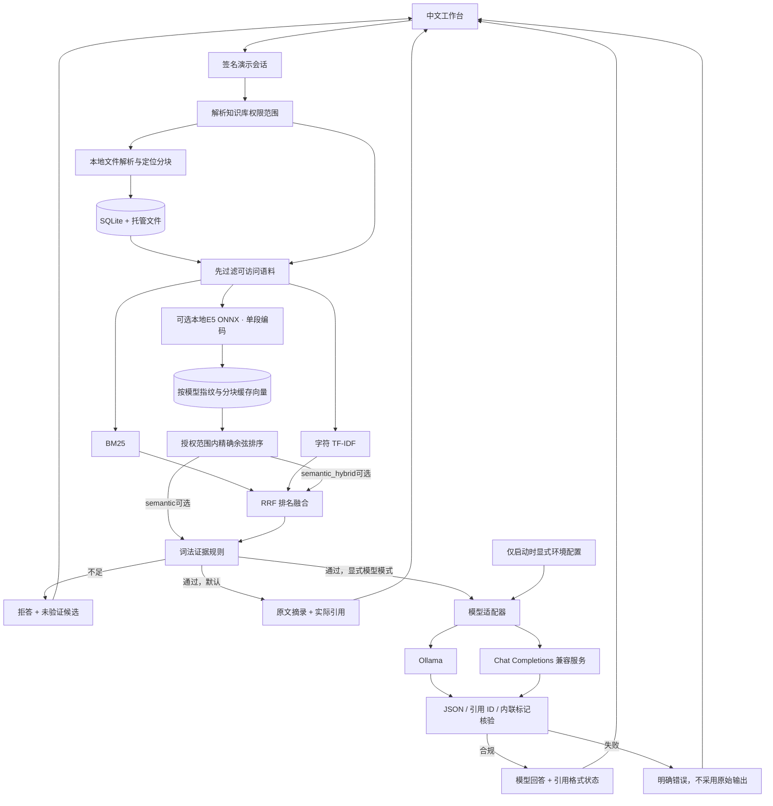
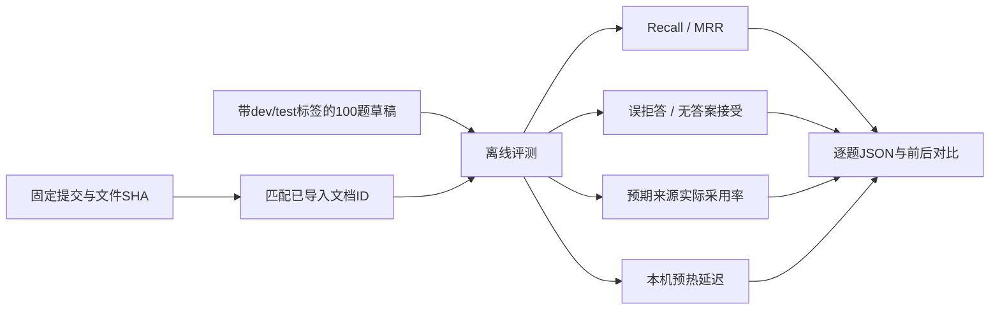

# KnowTrace 架构与数据流

模型适配是可选路径。默认离线模式没有推理请求，评测也始终调用离线核心。配置存在不表示模型可用；只有实际请求有了合规响应才记录最近成功时间。

## 模块职责

| 模块 | 职责 | 关键边界 |
|---|---|---|
| `parsing.py` | PDF / MD / TXT / DOCX提取、分块 | 物理页和逻辑行分清；压缩XML/文本量限额 |
| `core.py` | 文档管理、SQLite、权限范围、索引缓存 | 空权限不退化成管理员；跨实例修订号失效 |
| `retrieval.py` | 离线分词、检索、覆盖信号 | 仅在授权语料内计算统计量；不读评测答案 |
| `embeddings.py` / `semantic_config.py` | 校验本地E5文件、单段CPU编码、可选启动配置 | 不下载、不调用Hub；模型与批次策略指纹绑定缓存 |
| `generation.py` | 两类可选推理接口、输出校验 | 不执行工具；无来源不调用；错误脱敏 |
| `config.py` | 显式启动环境配置 | 不读密码保险箱；远程HTTPS；前端不接收密钥 |
| `evaluation.py` | 固定语料身份核验、检索/拒答评测 | 按文件哈希绑定文档ID；实际采用来源单独计量 |
| `app.py` / `web/` | 会话、API、工作台 | Host限制、跨域写防护、来源下载ACL、文本渲染、身份代次 |

## 引用究竟保证什么

离线摘录可以核对到文档内容与定位。词法门槛说明“有足够的关键词证据”，不能证明材料完整回答了问题。

模型路径只校验输出结构、引用是否属于准许的来源、正文标记是否对应。**没有做句子级语义蕴含判断**，不能写成“消除幻觉”。恶意文档仍可能影响模型文字；本应用不给模型工具执行能力，并拒绝不合规引用。

## 评测流

开发集用于实现选择；v0.1的test已经查看过，后续版本复验属于回归比较，不能冒充未见过的独立测试。数据标注未经独立人工复核，文档级命中/采用率都不等同于答案正确率。密集向量不绕过原准入门槛，也不把余弦分数当作支持概率。
